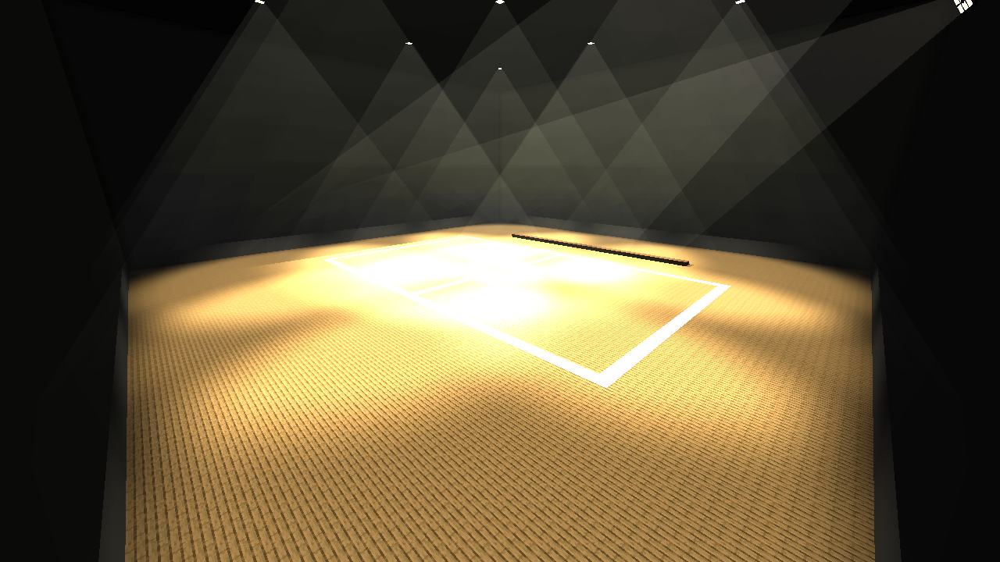
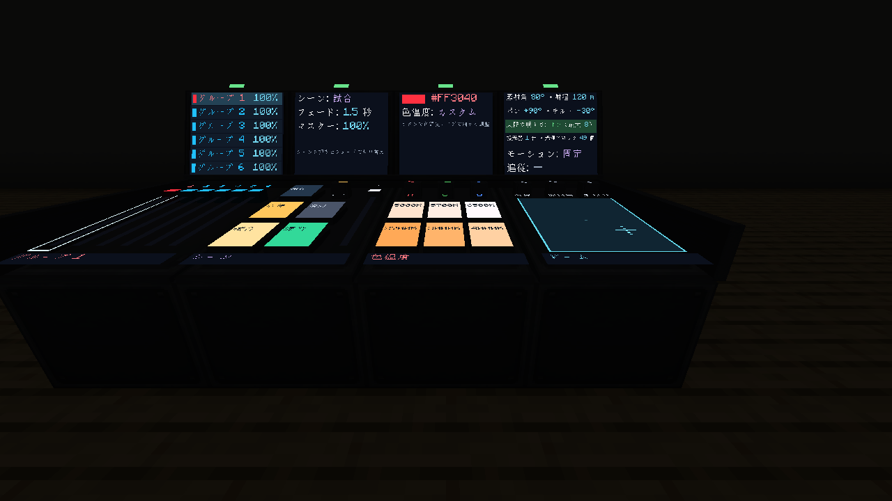
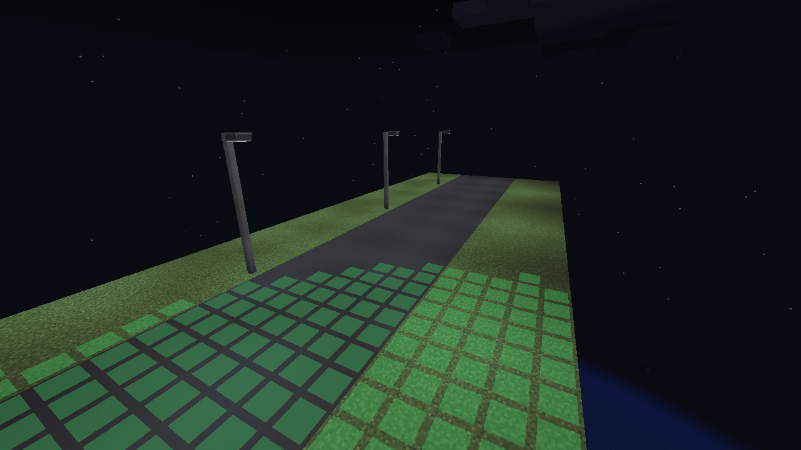

# Create: Large Lights

体育館・アリーナ・スタジアム向けの「投光器」を追加する [Create: Media Systems](https://github.com/haruyq/Create-Media-Systems) のアドオンです。

ビルド済みJAR: [create_large_lights-0.1.0.jar](releases/create_large_lights-0.1.0.jar)。対応するCMSのコミットは下の「ビルド」を参照してください。

バニラの光源は半径15ブロックまでしか届かないため、高い天井から床を照らすことができません。
CLLの投光器は、ブロックの実モデルとテクスチャの透明部分に合わせて、独自のGPU描画で光と影を重ねます。
単体で**最大256ブロック先**まで届き、**最大で直径約100ブロック**の床を照らします。



消灯時（バニラの光は届かない）: [docs/2_floodlights_off.png](docs/2_floodlights_off.png) ・ 床からの眺め: [docs/3_floor_view.png](docs/3_floor_view.png) ・
制御卓につないだ1台だけ、赤・照射角18°・明るさ40%・パン30°/チルト35°（真下から西へ30°起こす）で点灯（他はレッドストーンを切って消灯）: [docs/4_console_linked.png](docs/4_console_linked.png)

## ブロック

| ブロック | 射程 | 照射角 | 照らす範囲（当たった面の中心から） |
|---|---|---|---|
| 投光器 | 128ブロック | 20° / 35° / 50° / 70° | 半径24ブロック |
| 大型投光器 | 256ブロック | 25° / 40° / 60° / 80° | 半径48ブロック |
| 街灯 | 32ブロック（真下へ） | 120° | 半径12ブロック |

ほかに **街灯用ポール**（街灯を載せる柱）と **照度計**（明るさを調べる道具）があります。

## 使い方

どちらのモードでも、**実際の明るさ（ライトレベル）も上がります**（下の「実際の明るさ」を参照）。

### 照明制御卓に接続していないとき（レッドストーン制御）

- **点灯と明るさ**: レッドストーン信号で点灯し、信号レベル1〜15に応じて明るさが変わります（実際の明るさの上限も信号レベルに従います）。
- **照射角**: Createのレンチで右クリックするたびに切り替わります（投光器 20/35/50/70°、大型投光器 25/40/60/80°）。
- **射程**: 投光器128ブロック、大型投光器256ブロック。

### 照明制御卓に接続したとき（制御卓で全て制御）

CMSのLED調整用スパナで制御卓にリンクすると、レッドストーンとレンチは効かなくなり、制御卓のグループ設定で全て制御します。

| 項目 | 制御卓の操作 | 刻み |
|---|---|---|
| 明るさ | マスター × グループのフェーダー | 5% |
| 照射角 | 投光器ページの照射角ノブ | 1°（スニークで5°、投光器は70°・大型投光器は80°まで） |
| 照らせる範囲（射程） | 投光器ページの射程ノブ | 1ブロック（スニークで10、2〜300ブロック） |
| 色 | 投光器ページの色温度ボタン / RGB ノブ | RGB各1 |
| 向き | 投光器ページの向きパッドとモーション | パン ±180°、チルト ±85° |
| 実際の明るさ | 投光器ページのON/OFFと最大ライトレベル | レベル1 |

音楽や映像への連動もステージライトと同じように効きます（実際のライトレベルは連動させず、フェーダーの明るさに従います）。

**向き**: 投光器ごとに合わせた向き（下の「向き」）を基準に、グループのパン/チルトの分だけ動きます。
制御卓の初期値（パン 0°、チルト 35°）のときは基準の向きのままなので、リンクしただけでは向きは変わりません。
天井設置では、器具の基準の向きに対して上下左右へ傾きます。真下でもパンで照射先が横へ動き、チルトは真下の両側へ動かせます。
壁・床設置では従来どおり、パンを+にすると右（上から見て時計回り）へ、チルトを35°より大きくすると下へ向きます。
以前から天井設置に設定していたパン・チルトは、更新後に照射先を確認して調整してください。
モーション（首振り・円運動・プレイヤー追従）もステージライトと同じように動きます。
実際の明るさはパン/チルトに従います。モーション中は、基準のパン/チルト方向を照らします。

### 制御卓の投光器ページ

制御卓で投光器のグループを選ぶと、制御卓の右3区画が**投光器専用のページ**に切り替わります
（左の区画のグループフェーダーとグループ一覧は共通で、投光器のいないグループを選ぶと通常のページに戻ります）。



| 区画 | 内容 | 操作 |
|---|---|---|
| シーン | 試合・練習・清掃・消灯の4シーン、フェード時間、マスター | シーンを押すと、全グループの明るさとマスターがフェード時間をかけて切り替わります。「保存」→シーンで、今のフェーダーをそのシーンに保存。フェードはノブをスクロール（0〜10秒、スニークで0.1秒刻み）。途中でフェーダーを動かすとフェードは止まります |
| 色温度 | 2700K / 3000K / 4000K / 5000K / 5700K / 6500K、RGBノブ | ボタンでその白色に（色数1・カラーサイクルと映像連動はオフ）。RGBノブのスクロールで細かく調整（スニークで1刻み） |
| ビーム | 向きパッド（照射角に合わせた輪で幅を表示）、射程、照射角（投光器は70°・大型投光器は80°まで）、最大ライトレベル | パッドをドラッグでパン/チルト（中心が手で合わせた向き。スニーク＋右クリックで中心に戻す）。ノブはスクロール（射程はスニークで10、照射角は5刻み） |
| モニター | 照射角・射程、パン/チルト、実際の明るさ、台数、モーション、追従するプレイヤー | 「実際の明るさ」の行を押すとON/OFF、モーションと追従の行は押すかスクロールで切り替え |

**グループごとに照明の種類は1つ**: 制御卓のグループには、同じページを使う種類の照明しかつなげません。
最初につないだ照明でそのグループの種類が決まり（投光器・大型投光器ならCLLの投光器ページ、CMSのステージライト・レーザーなら通常ページ）、
別の種類をつなごうとするとLED調整用スパナが断ります。グループが空になれば、また別の種類をつなげます。

ページの設定（照射角・実際の明るさ・最大レベル・シーン・フェード）は制御卓に保存されます。

### タイマー（制御卓）

投光器ページの真ん中のモニターで、ゲーム内の時刻にシーンを自動で呼び出せます（4つまで）。
「タイマー」の行を押すと全体のON/OFF、各行は左から ON/OFF（押す）・時刻（スクロールで15分、スニークで1時間）・シーン（押すかスクロール）です。
時刻を過ぎるとそのシーンがフェードで呼び出されます。寝る・`/time` で時間が飛んだときは、飛び越えた最後のタイマーだけを呼び出し、時間を戻したときは何もしません。
タイマーは、その制御卓につながった投光器が読み込まれている間に動きます。

### 街灯

**街灯用ポール** を積んだ上に **街灯** を置くと、腕が置いた人の向いている方へ伸びます。
日照センサー内蔵で、暗くなると点灯、明るくなると消灯します（レッドストーン信号でも点灯）。
レンチで「自動／レッドストーンのみ」を切り替えられます。点灯中は真下の地面の実際の明るさを上げます。
描画処理を持たない普通のブロックなので、たくさん並べても軽く動きます。



### 照度計

手に持つと、周囲（半径12ブロック）のモブが立てる床に、照明による明るさで色が付きます。
赤は明るさ0（暗くてモブが湧く場所）、黄は1〜7、緑は8以上です。ホットバーの上に、指している場所の明るさ（照明と空の光）と、周囲の暗い場所の数が出ます。

### 向き（両モード共通）

- **設置**: 天井なら真下、壁なら外側へ35°下向き、床なら設置した人の向きへ斜め上に向きます。
- **向き合わせ**: 素手でスニーク＋右クリック → 照らしたい場所を右クリック（256ブロック先まで）。照明そのものをもう一度右クリックで中止。

### 表面の光と影

CLLの投光器・大型投光器は、ブロックの実モデルとテクスチャの透明部分から遮光を計算します。
影のデータは形状や照射方向が変わったときに更新し、色と明るさは毎フレーム反映します。
レンズ・空中のビーム・制御卓・音楽や映像との連動には、引き続きCMSの仕組みを使います。

標準の影の解像度は1024×1024です。128・256ブロック先では、細い鉄格子やフェンスの影に粗さやちらつきが残る場合があります。
独自のブロックエンティティ描画など、通常の実モデル以外の形状は個別の確認が必要です。

共有する形状のキャッシュは最大64MiBです。数値が完全に一致する頂点を共有し、特殊形状の面やテクスチャ、面ごとの法線を保ったままデータ量を減らします。
影の深度画像は必要な灯数に応じて確保し、最大128枚・512MiBに制限しています。
129灯以上も描画しますが、保持できない影は再計算するため負荷が増えます。しばらく使われなかった影、資源の再読込やワールド退出時のキャッシュは解放します。
照らす面が画面外にある照明は、そのフレームの表面描画と影の更新を省きます。
表面への照射は最大4灯分をまとめ、共通の形状とテクスチャを繰り返し処理する負荷を抑えます。
各灯の影・色・減衰・強さの上限は個別に計算し、影の更新を間引きません。

光が完全に遮られる壁面や、六面が不透明な壁で閉じた空間を確認できた場合は、その奥の形状走査を省きます。
設定した射程による減衰は維持し、穴・透明部分・特殊形状がある場合は遮られると確認できた区画だけを除外します。
空中のビームの当たり判定も、実際に走査した範囲のブロック変更時に更新するため、遠くの変更で全灯を走査し直しません。

初回や形状変更後は、共有するGPU用形状の準備が完了した照明から、表面の光と影を順次表示します。
準備中に照明ごとのCMS形状走査を並行して行わないため、多数の特殊形状がある場面での負荷とメモリ増加を抑えます。
GPU機能が使えない環境、Irisのシェーダーパック使用中、光源や照射範囲にSable構造物がある場合、Ponder、GPU用形状の上限を超える場合はCMSの表面描画を使います。

### 実際の明るさ

投光器ごとの照度データを使い、ビーム内の各ブロックの明るさを計算します。見えない光源ブロックは設置しません。
照明の近くは狭く強く、遠くは広く弱くなり、重なる照明の寄与は加算されます（最大レベル15）。
照度はサーバーで計算し、必要な区画ごとにクライアントへ同期します。更新は処理量の上限を設けて順次反映するため、対象が多い場面では反映に待ち時間が生じます。

遮光用のブロック情報を照明間で共有し、区画をさらに4×4×4に分け、光が届かない領域を計算から除外します。
各ブロックの照度と特殊形状の遮蔽判定は従来どおり計算します。射程・照射角・明るさだけの変更では、同じ位置からの遮蔽判定を再利用します。
同期計算はサーバーの処理時間に応じて1tickあたり2〜8msを使い、クライアントから要求された区画を優先します。
照度が変わらない区画は再送しないため、不要な地形・Flywheelの描画更新も抑えます。
同じtick内の照明変更は区画ごとにまとめ、同期対象を繰り返し判定しません。
空の4×4×4領域・16×16×16区画ではブロック情報への問い合わせを省き、光線の通過順と特殊形状の交差判定は保ちます。
遮蔽結果のビット配列は全体で最大8MiBを保持します。区画ごとの16灯制限をなくし、参照された結果を優先して再利用します。

- 照射範囲の外へCLLの明るさは伝播しません。松明など、ほかの光源の明るさは保たれます。
- 消灯・向きの変更・照射角の変更・投光器の破壊で、照度データを更新します。
- 通常のブロック照度を通して、モブの湧き潰しや作物の成長にも効きます。専用の照明処理を持つ他modは個別の互換性確認が必要です。
- クライアントの区画単位の明るさ取得とFlywheelの高速描画にも照度を反映します。合成データは最大512区画・約1MiBを再利用し、点灯・消灯時には通常の光更新を通知します。
- ワールドごとの設定 `serverconfig/create_large_lights-server.toml` の `realLight = false` で無効化できます。
- 旧版が配置した光源ブロックは、保存された所有情報に従って取り除きます。
- 動くSable構造物の上の投光器は、実際の明るさを出しません。

## 必要なもの

- Minecraft 1.21.1 / NeoForge 21.1
- Create 6.0.10 以降
- Create: Media Systems（下の`cms_revision`で指定したコミットからビルドしたもの）
- Java 21

## ビルド

CMS本体の光線・照射面・変更通知へのMixinは使わず、公開APIの`FixtureOptics`・`WorldChanges`を使います。
制御卓ページ・設定参照・操作送信、Sable座標変換、Irisの状態取得も公開APIへ移行しています。
Minecraft・Flywheel・CLL自身へのMixinは引き続き使用します。

照明・SableのAPIはCMS側で実験段階とされているため、実行時の対応範囲は **CMS 1.4.6以上、1.5未満** です。
照明の基底クラスや描画フォールバックなど、公開APIに対応口がない部分は、CMSが2.0まで互換性を保持する旧インターフェイスを使用します。
移行範囲と検証結果は[CMS公開APIへの移行記録](docs/cms-public-api-2026-11-12.md)を参照してください。

CMSは`gradle.properties`の`cms_revision`で指定したコミットのソースからビルドします。
CLLのZIPにはCMSのソースは含まれないため、ビルドにはGitと、別途取得したCMSのソースが必要です。
既定の場所は隣の`../Create-Media-Systems`です。CLLの`gradlew.bat`・`gradlew`があるフォルダーで、初回は次のように準備します。

```bash
git clone https://github.com/haruyq/Create-Media-Systems.git ../Create-Media-Systems
git -C ../Create-Media-Systems checkout a7490922ea23bbf50aa1a39e3cd29b027c8b5ae0
```

Windows（PowerShell）:

```powershell
.\gradlew.bat build "-PcmsPath=../Create-Media-Systems"
```

Linux・macOS:

```bash
./gradlew build -PcmsPath=../Create-Media-Systems
```

`CMS source checkout is required`は、CMSのソースが指定先にないという意味です。
上の準備を行い、`-PcmsPath`に取得先を指定してビルドしてください。完成したJARは`build/libs/`に生成されます。

既存のcheckoutを使う場合は、fetch後に指定コミットへ合わせます。
通常ビルドでもこのコミットを使い、CMSのHEADが一致しなければ停止します。使用したコミットはJARの`CMS-Commit`にも記録します。
別の場所のcheckoutは`cmsPath`で指定できます。

```bash
./gradlew build -PcmsPath=/path/to/Create-Media-Systems
```

CLL独自のGPU描画と実照度は引き続き使用します。CMSの表面描画へ戻る場面では、使用するCMS版の描画上の制約も受けます。

デモ（体育館を自動で作り、実際の明るさ・レンチ・制御卓での制御を確かめてログに `CHECK PASS/FAIL` を出し、撮影して終了します。スクリーンショットは `run-demo/screenshots/`）:

```bash
./gradlew -Pdemo runClient
```

鉄格子・フェンス・上下ハーフブロック・階段への描画を確認する専用シーン:

```bash
./gradlew -PshapeDemo runClient
```

補助の環境光を置かず、青色の投光器だけで各形状を比較し、実モデルへの照射・透過判定と照度データをログの
`SHAPE CHECK PASS/FAIL` で確認します。描画用の遮光判定はモデルの面とテクスチャの透明部分を使うため、
鉄格子やフェンスの当たり判定が、見えている面や隙間を余分に遮りません。


CPU描画と本番GPU描画の比較用シーン（デモ用コードは通常ビルドには含まれません）:

```bash
./gradlew -PgpuDemo -PgpuMode=cpu -PgpuAngle=oblique -PgpuLights=16 runClient
./gradlew -PgpuDemo -PgpuMode=production -PgpuAngle=oblique -PgpuLights=16 runClient
./gradlew -PgpuDemo -PgpuMode=cms -PgpuAngle=oblique -PgpuLights=16 runClient
```

`gpuAngle=vertical` で真上からの照射、`gpuLights=1` で単灯を比較できます。
全灯の位置・色・明るさ・照射角・射程の一致を検証し、実光量をOFFにして表面投影だけを測定します。
`gpuMode=gpu` は比較用の旧GPU試作です。この試作だけは `-PshadowSize=1024` などで影の解像度を変更できます。
`gpuMode=cms` は比較用にCLLの`FixtureOptics`登録を省き、CMS本来の光線判定と表面描画を使います。検証用MixinもCLL自身だけを対象にしています。
異なるCMSコミットを比較する場合は、対応するcheckoutと`-Pcms_revision=<コミット>`を揃えて指定します。

多数の特殊形状とCreateコピーキャットを置いた81×81×66ブロックの空間で、実光量をONにした多灯計測:

```bash
./gradlew -PgpuDemo -PgpuMode=production -PgpuPerf -PgpuLights=64 runClient
```

`-PgpuLights=128`では制御卓2台を使います。`-PgpuMotion=1`で首振り中の負荷を測定します。
`-PgpuHeight=20 -PgpuAngle=vertical -PgpuRange=128`と`-PgpuRange=256`で、床までの距離を変えずに設定射程だけを比較できます。
ログの`GPU_TRIAL_BENCH`と`PERF_PRODUCTION`にフレーム時間・GPU時間・影の更新回数・キャッシュ使用量を、`PERF_FIELD`に実照度の更新待ち区画数と処理時間を出力します。
射程128・256の比較、広域照射・首振りの計測、検証結果と残る待ち時間は[軽量化の検証記録](docs/performance-2026-11.md)を参照してください。
多灯描画・照度計算の追加軽量化は[多灯処理の検証記録](docs/performance-multilight-2026-11.md)を参照してください。
`-PgpuCheck`を追加すると、従来の1灯ずつの描画と新しい多灯描画を浮動小数点バッファで比較します。検証処理が計測に加わるため、通常の速度比較とは別に実行してください。

本番GPU経路のフェード・色・遮蔽物・向きの更新、資源の再読込と解放を検証するデモ:

```bash
./gradlew -PproductionDemo runClient
```

128・256ブロック上のライトで床を照らす長距離シーン:

```bash
./gradlew -PfarDemo -PfarDistance=128 runClient
./gradlew -PfarDemo -PfarDistance=256 runClient
```

照度の加算・境界・遮蔽・サーバー同期と、CreateコピーキャットのModelData更新を検証する短いデモ:

```bash
./gradlew -PfieldDemo runClient
```

体育館デモを外部のComputer Useで撮影する場合は、`-Pdemo -PexternalCaptures` を使用するとゲーム内の自動撮影を止められます。

## ライセンス

MIT
